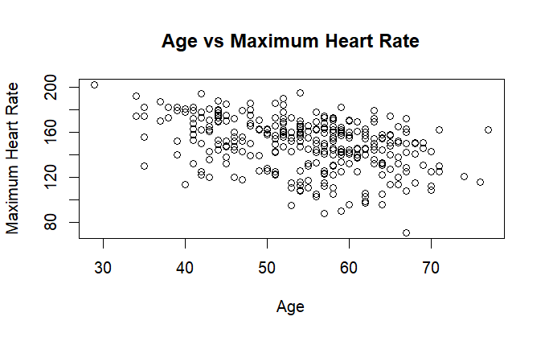
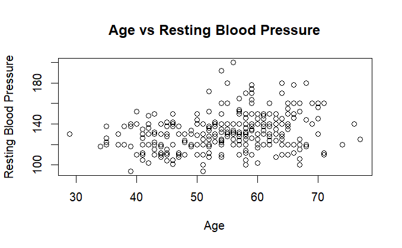
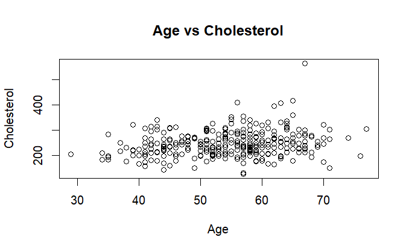

# Heart Disease Statistical Analysis in R

## Project Overview

In this project, I explored a heart disease dataset using R and statistical techniques. My aim was to understand the relationships between age, maximum heart rate, resting blood pressure and cholesterol. I used descriptive statistics, correlation analysis and scatter plots to identify patterns and relationships within the dataset.

The dataset contains **1,025 observations and 14 variables**.

## Tools and Technologies

- R
- RStudio
- R Markdown
- Statistical Analysis
- Data Visualisation

## Analysis Performed

The project involved:

- Exploring the dataset using `head()`, `str()` and `summary()`.
- Calculating descriptive statistics.
- Creating scatter plots to examine relationships between variables.
- Using Pearson correlation to measure the strength and direction of relationships.
- Creating a boxplot to compare maximum heart rate between sex groups.

## Key Findings and Results

### Relationship Between Age and Health Measurements

### 1. Age vs Maximum Heart Rate
I found a downward trend between age and maximum heart rate. This is supported by a Pearson correlation coefficient of -0.3902, indicating a moderate negative relationship. This suggests that older individuals in the dataset generally tend to have lower maximum heart rates.

### 2. Age vs Resting Blood Pressure
I observed a slight upward trend between age and resting blood pressure. The Pearson correlation coefficient of 0.2711 indicates a weak positive relationship. This suggests that resting blood pressure tends to increase slightly with age.

### 3. Age vs Cholesterol
I observed a slight upward pattern between age and cholesterol levels. The Pearson correlation coefficient of 0.2198 indicates a weak positive relationship. However, the wide spread of points suggests that age alone does not strongly explain cholesterol levels.

## Conclusion

Through this analysis, I identified different relationships between age and three health-related measurements. The strongest relationship I found was between age and maximum heart rate, which showed a moderate negative correlation. Resting blood pressure and cholesterol both showed weak positive correlations with age. Although the correlation tests were statistically significant, my regression results showed that these variables alone explained only a limited proportion of the variation. Overall, this project allowed me to demonstrate my skills in using R for data exploration, statistical analysis, correlation and data visualisation.

## Dataset

The dataset was obtained from Kaggle:

[Heart Disease Dataset – Kaggle](https://www.kaggle.com/datasets/johnsmith88/heart-disease-dataset)

## Project Files

- `heart_disease_analysis_markdown.Rmd` – R Markdown source code containing the analysis.
- `images/` – Folder containing the scatter plot visualisations and boxplot.

## Author
Olasunkanmi Adisa
